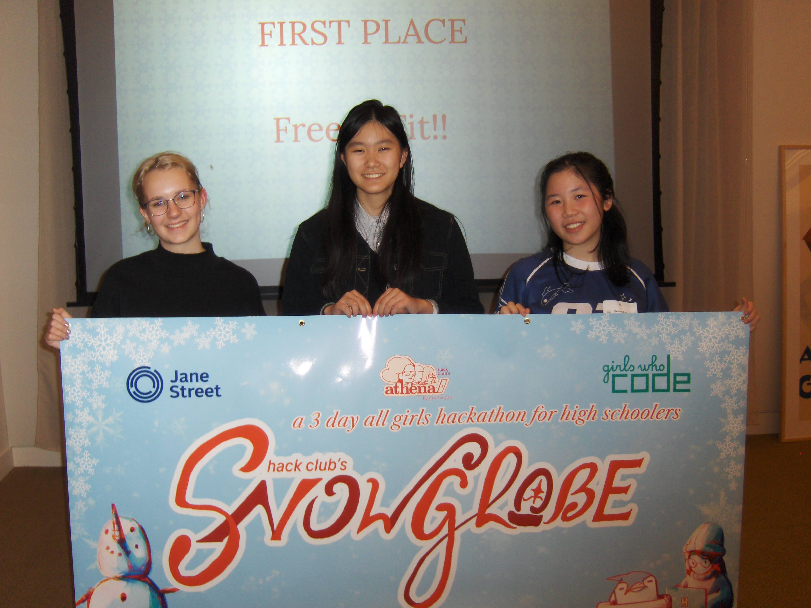
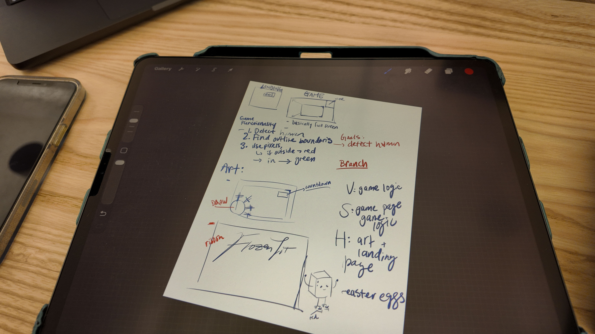
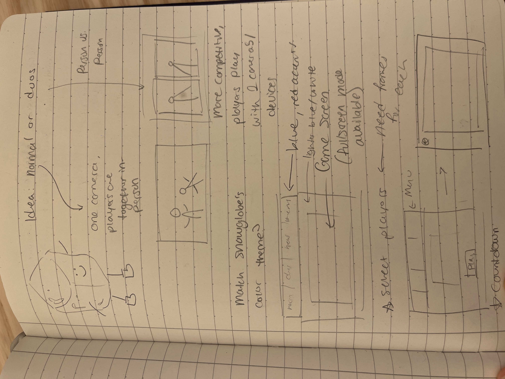
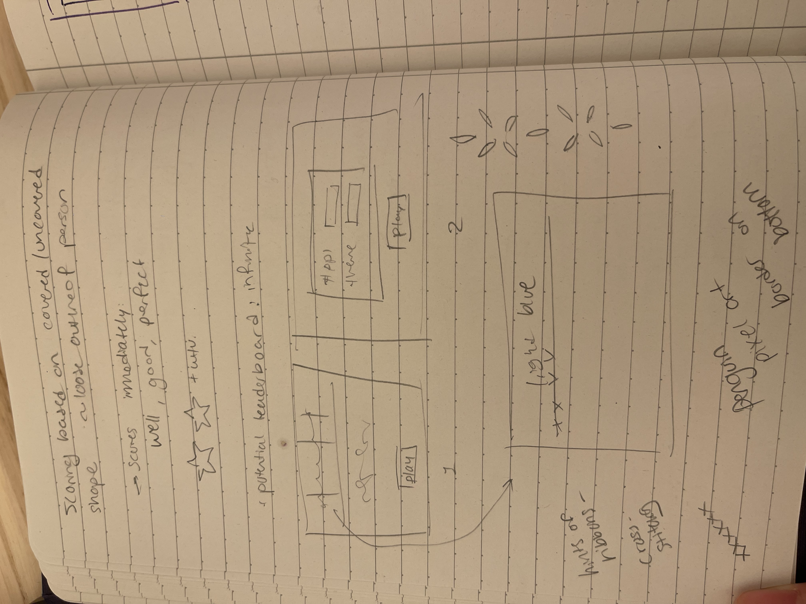
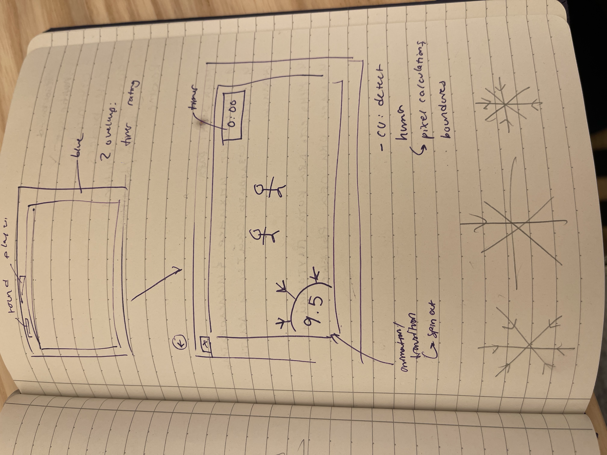

# Frozen Fit

**Live Demo:** https://snowglobe-frozen-fit.vercel.app/

**Built By:** [@varvarakarenski](https://github.com/varvarakarenski) Varvara Karenski, [@heonaliu](https://github.com/heonaliu) Heona Liu, [@shelxty](https://github.com/shelxty) Shelley Ma
- Varvara worked on the body detection mechanism with computer vision
- Heona worked on all the assets and hooking the leaderboard with firebase firestore
- Shelley worked on the landing page layout and leaderboard

- It won 1st in Hack Club Athena's Snowglobe event hosted on Nov 20-22, 2026 in San Francisco, California at Notion Headquarters!

## Description
Twist yourself into shapes, and fit yourselves in as best as possible! 

This is Freeze Fit, inspired by Level99 games in Boston & a Roblox game (ifykyk).

Team up to make a group of 2-5 people (or play solo!), and follow the prompts on the screen. A shape will appear, and you and your friends have to try to fill in the shape as best as possible, while not spilling outside the borders. Crouch, jump, starfish, anything goes! The better you fill the shape, the higher your score will be! 

# How to Play:
1. Grab your friends! 2-5 will suffice!
2. Work together into a pose to fill up the area into a shape
3. Get a scores based on how you all froze! The higher the better!

# Technical Overview

Frozen Fit runs entirely in the browser, with the camera/body/scoring all client-side. The leaderboard, however, is stored in a Firebase database. 

**Languages/Libraries used:**
- UI is done via React 19
- Routing was made with React Router 7 (to connect the home, game, results, and leaderboard page without page reloads)
- Body detection is done with MediaPipe Tasks Vision
- The permanent leaderboard is stored with Firebase Firestore.
- Styling is done with plain CSS.
- The camera is opened with `getuserMedia` API (it just needs `https` or `localhost`).

## What was Hard, and How we Fixed it
- Our team had various strengths so it took sometime for us to sort who would be best to do what role. Afterwards it was pretty smooth. We also had to communicate when we pushed our changes and worked with git branch system! Additionally, sometimes we'd look too far ahead and forget to consider the time constraints of the event. To fix that, we wrote down every feature we wanted and categorized them as "Would be Nice to Have" vs. "Must Have."

**Scoring Poses Fairly.** "How well do you fit the shape" is fuzzy, so we made it a pixel count. MediaPipe gives us a mask of where people are, and the shape is another mask the same size. Every pixel is either inside the shape (good), outside it (spilled over), or a part of the shape nobody filled (a gap). The fit is `inside / (inside + outside + gaps)` (Intersection over Union), so you can't win by just standing in front of the whole shape.

**Blocky Body Masks.** The raw mask is jagged and pixelated, and the green/red fit map looked like a broken TV. We run it through an SVG "goo" filter (blur, then sharpen the edge back up), which turns the blocks into smooth blobs.

## (Really Cool) Process Work

## What's Next
- Make it multiplayer in the future so people can play with their friends on separate laptops
- Add more outline shapes and styles!

## Run it Yourself

1. Clone the repo: `git clone https://github.com/heonaliu/snowglobe-frozen-fit.git && cd snowglobe-frozen-fit`
2. Install dependencies: `npm install`
3. Copy `.env.example` to `.env` (`cp .env.example .env`) and fill in the six `VITE_FIREBASE_*` values: `API_KEY`, `AUTH_DOMAIN`, `PROJECT_ID`, `STORAGE_BUCKET`, `MESSAGING_SENDER_ID`, `APP_ID`. They're in the Firebase console under Project settings → General → Your apps → SDK setup and configuration. If you're really nice to us, we'll give you access to the Firebase.
4. Start it: `npm run dev`, then open the address it prints (usually http://localhost:5173) and allow camera access
