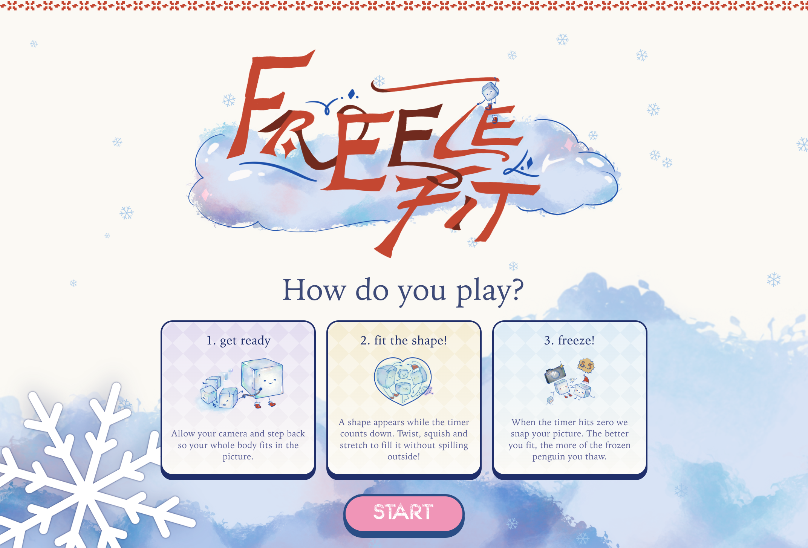

---

Twist yourself into shapes, and fit yourselves in as best as possible! 

This is Freeze Fit, inspired by Level99 games in Boston & a Roblox game (ifykyk).

Team up to make a group of 2-5 people (or play solo!), and follow the prompts on the screen. A shape will appear, and you and your friends have to try to fill in the shape as best as possible, while not spilling outside the borders. Crouch, jump, starfish, anything goes! The better you fill the shape, the higher your score will be! 

# How to Play:
1. Grab your friends! 2-5 will suffice!
2. Work together into a pose to fill up the area into a shape
3. Get a scores based on how you all froze! The higher the better!

# Technical Overview

Frozen Fit runs entirely in the browser, with the camera/body/scoring all client-side. The leaderboard, however, is stored in a Firebase database. 

**Languages/Libraries used:**
- UI is done via React 19
- Routing was made with React Router 7 (to connect the home, game, results, and leaderboard page without page reloads)
- Body detection is done with MediaPipe Tasks Vision
- The permanent leaderboard is stored with Firebase Firestore.
- Styling is done with plain CSS.
- The camera is opened with `getuserMedia` API (it just needs `https` or `localhost`).

All of the (absolutely incredible) art is made by Heona! 
